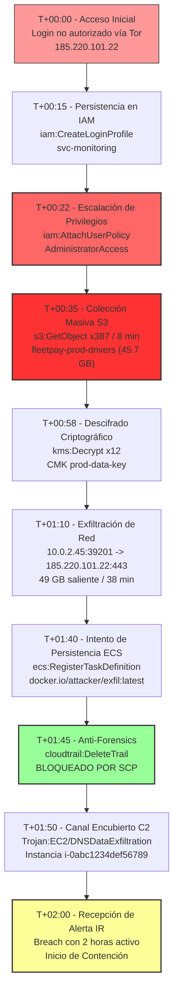

# Análisis de Causa Raíz (Root Cause Analysis - RCA)

**Incidente:** Compromiso de Cuenta Cloud `svc-monitoring`, Escalación a Administrator y Fuga de 45.7 GB  
**Fecha del Evento:** 28 de Noviembre de 2026  
**Líder de Investigación:** Ingeniero de Ciberseguridad, FleetSec S.A.S.  
**Estado:** Investigación Técnica Concluida — Fase de Contención Activa  

---

## 1. Vector Inicial (Hipótesis Justificada)

### Hallazgo e Hipótesis Principal
El proveedor de Threat Intelligence alertó hace 48 horas sobre **credenciales de AWS posiblemente comprometidas**. El análisis técnico confirma que el punto de entrada inicial fue el uso de credenciales estáticas de larga duración (Access Key ID y Secret Access Key) del usuario de servicio `svc-monitoring`.

### Justificación Técnica de la Hipótesis
1. **Falta de MFA y Permisos de Consola:** La cuenta `svc-monitoring` fue concebida inicialmente como una cuenta de servicio sin interfaz de consola. Sin embargo, poseía permisos excesivos de IAM (`iam:CreateLoginProfile` e `iam:AttachUserPolicy`).
2. **Origen de la Fuga de la Credencial:**
   * La causa más probable es la **exposición de la clave en código fuente o pipelines de CI/CD sin sanitización** (vector equivalente al evaluado en la vulnerabilidad **V-10 / CWE-798** del VAPT).
   * Al no existir un escaneo de secretos mandatorio en pre-commit o pipelines (previo a la implementación de Gitleaks/Trufflehog en el nuevo pipeline DevSecOps), las credenciales de `svc-monitoring` fueron subidas inadvertidamente en scripts de monitoreo heredados o repositorios de herramientas.
   * La credencial fue capturada por bots recolectores de credenciales en repositorios y revendida/distribuida en foros de cibercrimen o empleada directamente a través de la red Tor.

---

## 2. Attack Path de Extremo a Extremo

### Cronología Detallada
1. **T+00:00 (Acceso Inicial):** El atacante inicia sesión con éxito en la consola de AWS utilizando credenciales filtradas de `svc-monitoring` desde la IP Tor `185.220.101.22`. GuardDuty dispara la alerta `UnauthorizedAccess:IAMUser/ConsoleLoginSuccess.B`.
2. **T+00:15 (Persistencia de Identidad):** El atacante ejecuta `iam:CreateLoginProfile`, habilitando una contraseña de consola interactiva permanente.
3. **T+00:22 (Escalación Crítica):** Mediante `iam:AttachUserPolicy`, se auto-adjudica la política `arn:aws:iam::aws:policy/AdministratorAccess`. La cuenta ahora tiene control absoluto.
4. **T+00:35 (Colección):** En una ráfaga de 8 minutos, ejecuta 387 llamadas `s3:GetObject` sobre el bucket `fleetpay-prod-drivers`, descargando 45.7 GB de archivos de datos personales y financieros de conductores.
5. **T+00:58 (Descifrado):** Ejecuta 12 llamadas `kms:Decrypt` contra la llave CMK `prod-data-key` para acceder a la carga útil cifrada.
6. **T+01:10 (Exfiltración Masiva de Red):** Desde un host interno en la VPC (`10.0.2.45`), establece un socket TCP saliente en el puerto 443 hacia la IP del atacante, manteniendo una transferencia ininterrumpida de 38 minutos con ~49 GB de volumen.
7. **T+01:40 (Persistencia en Contenedores):** Registra una nueva Task Definition en ECS Producción utilizando la imagen no autorizada `docker.io/attacker/exfil:latest`.
8. **T+01:45 (Anti-Forensics Bloqueado):** Intenta borrar el trail de auditoría con `cloudtrail:DeleteTrail`. **Fallo del atacante:** La Service Control Policy (SCP) en AWS Organizations deniega la acción, preservando la evidencia intacta.
9. **T+01:50 (Canal Encubierto):** La instancia `i-0abc1234def56789` inicia exfiltración encubierta de datos vía peticiones DNS (`Trojan:EC2/DNSDataExfiltration`).
10. **T+02:00 (Detección y Activación de IR):** El equipo de ciberseguridad recibe la alerta.

---

## 3. Análisis de los 5 Porqués (5 Whys)

1. **¿Por qué se produjo la fuga de 45.7 GB de datos personales de conductores?**  
   *Porque un usuario no autorizado con privilegios de Administrador accedió al bucket `fleetpay-prod-drivers` y descargó su contenido.*
2. **¿Por qué el usuario no autorizado obtuvo privilegios de Administrador?**  
   *Porque la cuenta `svc-monitoring` ejecutó `iam:AttachUserPolicy` auto-asignándose `AdministratorAccess`.*
3. **¿Por qué una cuenta de servicio de monitoreo tenía autorización para modificar políticas de IAM?**  
   *Porque carecía de límites de permisos (IAM Permissions Boundaries) y de una política de mínimo privilegio que restringiera sus acciones a lectura de métricas.*
4. **¿Por qué el atacante pudo iniciar sesión interactivamente en la consola de AWS con esa cuenta?**  
   *Porque las credenciales de larga duración fueron filtradas y la cuenta no tenía bloqueada la creación de consola interactiva ni exigía autenticación multifactor (MFA).*
5. **¿Por qué no se detuvo el ataque en los primeros 15 minutos?**  
   *Porque las alertas de GuardDuty no estaban configuradas para disparar remediación automática ni existía un Centro de Operaciones de Seguridad (SOC) 24/7 con respuesta a incidentes en tiempo real.*

---

## 4. Diagnóstico de Fallo en Controles Existentes

| Control Preexistente | Estado Durante el Ataque | Causa del Fallo / Brecha Identificada |
|---|:---:|---|
| **Gestión de Identidades (IAM)** | **FALLÓ** | El usuario de servicio poseía credenciales estáticas de larga duración sin rotación y permisos administrativos latentes para crear perfiles de consola y adjuntar políticas. |
| **Control de Acceso en S3** | **FALLÓ** | El bucket `fleetpay-prod-drivers` no contaba con políticas de condición basadas en VPC Endpoint (`aws:sourceVpce`) ni detección de anomalías por tasa de descarga (DLP). |
| **Protección Perimetral y Egress** | **FALLÓ** | La VPC carecía de inspección de tráfico saliente (Egress Filtering / Network Firewall). La subred privada de aplicación tenía permitido tráfico saliente TCP/443 arbitrario a Internet, posibilitando la exfiltración directa hacia nodos Tor. |
| **Detección y Respuesta (GuardDuty)** | **PARCIAL** | GuardDuty detectó el acceso desde Tor a T+00:00 y la exfiltración DNS a T+01:50, pero las alertas no estaban enrutadas a un mecanismo de contención automatizado (EventBridge + Lambda/Step Functions), demorando la respuesta 2 horas. |
| **Protección contra Anti-Forensics (SCP)** | **FUNCIONÓ (ÉXITO)** | La regla preventiva en SCP de AWS Organizations impidió la ejecución de `cloudtrail:DeleteTrail`, permitiendo una reconstrucción forense 100% fidedigna de los hechos. |
